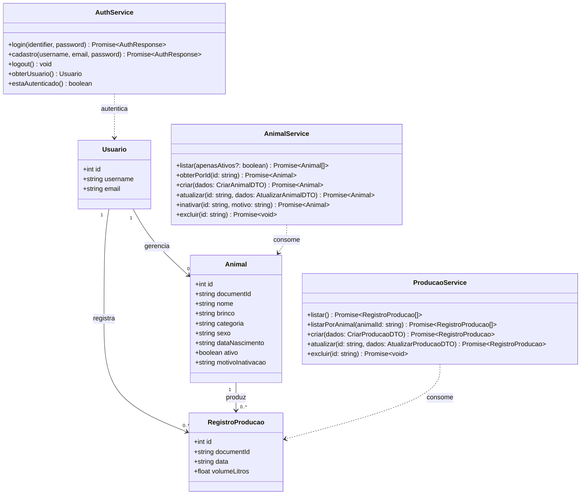

# 📋 Plano de Execução do Projeto: Fazenda Digital

Este plano estabelece todo o escopo, arquitetura, entregas e etapas de implementação do sistema **Fazenda Digital**, concebido a partir do [roteiro de entrevista](file:///c:/Users/Kauã%20Lima/workspace/QXD0253-nosdois/docs/roteiro-entrevista.md) com o produtor rural.


## 1. 🎯 Diretrizes e Escopo da Demanda

Em conformidade estrita com as restrições informadas:
1. **Sem Complexidade Excessiva:** O sistema conterá no máximo **2 operações completas de CRUD**, eliminando módulos desnecessários.
2. **Stack Leve e Simples:** Utilização exclusiva de **HTML, CSS e TypeScript (TS)** no frontend (com empacotamento via Vite), integrando-se à API REST do **Strapi v5** no backend.

### Definição dos 2 CRUDs:
* **CRUD 1 — Gestão do Rebanho (Animais):**
  * **Create:** Cadastro com Nome (obrigatório), Brinco (opcional/único), Categoria (`vaca`, `bezerro`, `garrote`, `novilho`), Sexo (`femea`, `macho`) e Data de Nascimento.
  * **Read:** Listagem com filtro por status (Ativos/Inativos) e busca textual em tempo real por nome ou brinco.
  * **Update:** Edição dos dados cadastrais do animal.
  * **Delete / Inativação:** Inativação lógica com justificativa obrigatória (`venda`, `morte`, `descarte`) para preservar a rastreabilidade histórica.

* **CRUD 2 — Registro de Produção de Leite:**
  * **Create:** Lançamento de ordenha individual associada a uma vaca ativa, com data e volume em litros.
  * **Read:** Tabela cronológica dos lançamentos recentes e consulta por período/vaca.
  * **Update:** Correção de lançamentos de volume ou data incorretos.
  * **Delete:** Exclusão física de registros incorretos ou duplicados.

* **Módulo de Apoio (Autenticação Básica):**
  * Login e cadastro simples de produtor rural para emissão e validação de token JWT no backend Strapi, garantindo o isolamento dos dados da propriedade.


## 2. 📦 Lista Completa de Entregáveis

```
+-----------------------------------------------------------------------------------+
|                              MAPA DE ENTREGÁVEIS                                  |
+-----------------------------------------------------------------------------------+
| 1. DOCUMENTAÇÃO TÉCNICA (docs/estrutura.md)                                       |
|    ├── Especificação de Requisitos e Regras de Negócio                            |
|    ├── Diagrama de Classes do Domínio e Serviços (Mermaid)                        |
|    ├── Diagramas de Sequência: CRUD Animais, CRUD Produção e Autenticação         |
|    ├── Mapeamento de Contratos de API REST (Endpoints Strapi)                     |
|    └── Guia Passo a Passo de Execução Local                                       |
+-----------------------------------------------------------------------------------+
| 2. ESTRUTURA BASE DO FRONTEND (frontend/)                                         |
|    ├── vite.config.ts (Configuração Multi-Page Application)                       |
|    ├── src/types.ts (Interfaces de Domínio, Enums e DTOs)                         |
|    ├── src/style.css (Design System simples, responsivo e de alto contraste)      |
|    └── src/service/ (api.ts, animalService.ts, producaoService.ts, authService.ts)|
+-----------------------------------------------------------------------------------+
| 3. INTERFACES E COMPORTAMENTOS (HTML + CSS + TS)                                  |
|    ├── CRUD 1: src/pages/animais/animais.html + animais.ts                        |
|    ├── CRUD 2: src/pages/animais/producao.html + producao.ts                      |
|    ├── Dashboard/Início: index.html + src/index.ts                                |
|    ├── Histórico Consolidado: src/pages/usuario/historico.html + historico.ts     |
|    └── Autenticação: login.html/.ts e cadastro.html/.ts                           |
+-----------------------------------------------------------------------------------+
| 4. VALIDAÇÃO E HOMOLOGAÇÃO                                                        |
|    ├── Verificação de integridade dos tipos TypeScript (sem erros de compilação)   |
|    └── Teste de consumo das rotas da API REST do Strapi                           |
+-----------------------------------------------------------------------------------+
```


## 3. 📐 Modelagem e Arquitetura Planejada

### 3.1. Diagrama de Classes Proposto (Mermaid)



### 3.2. Diagramas de Sequência Planejados

1. **Sequência 1: CRUD de Animais**
   * *Atores:* Produtor $\rightarrow$ `animais.html` $\rightarrow$ `animais.ts` $\rightarrow$ `animalService.ts` $\rightarrow$ Strapi `/api/animals`.
   * *Fluxo:* Submissão do formulário, validação de unicidade de brinco/nome, resposta HTTP 201 e atualização reativa da listagem no DOM.

2. **Sequência 2: CRUD de Produção de Leite**
   * *Atores:* Produtor $\rightarrow$ `producao.html` $\rightarrow$ `producao.ts` $\rightarrow$ `producaoService.ts` $\rightarrow$ Strapi `/api/registros-producao`.
   * *Fluxo:* Carga do `<select>` com vacas ativas, validação de volume positivo ($> 0$), submissão e inserção na tabela de histórico.

3. **Sequência 3: Autenticação e Sessão JWT**
   * *Atores:* Produtor $\rightarrow$ `login.html` $\rightarrow$ `authService.ts` $\rightarrow$ Strapi `/api/auth/local` $\rightarrow$ `localStorage` $\rightarrow$ Interceptor do Axios.


## 4. 🗓️ Etapas de Execução do Plano

| Etapa | Atividade | Entregáveis Concretos |
| :---: | :--- | :--- |
| **Fase 1** | **Aprovação do Plano (Etapa Atual)** | Revisão do escopo e alinhamento com o usuário antes de qualquer código novo. |
| **Fase 2** | **Documentação Técnica Completa** | Entrega do arquivo `docs/estrutura.md` com os diagramas de classe e sequência renderizáveis em Mermaid, contratos de API e regras de negócio. |
| **Fase 3** | **Estrutura Base e Serviços Frontend** | Definição de `vite.config.ts`, `src/types.ts`, `src/service/` (`api.ts`, `animalService.ts`, `producaoService.ts`, `authService.ts`) e `src/style.css`. |
| **Fase 4** | **Implementação do CRUD 1 (Animais)** | Telas e scripts de `animais.html` e `animais.ts` com validações, filtros e inativação por motivo. |
| **Fase 5** | **Implementação do CRUD 2 (Produção)** | Telas e scripts de `producao.html` e `producao.ts` com seleção de vacas lactantes e cálculo de ordenha. |
| **Fase 6** | **Telas Auxiliares e Integração Final** | Implementação de `index.html`, `historico.html`, fluxos de login/cadastro e testes de integridade. |


## 5. ❓ Decisões para Validação do Usuário

Antes de prosseguirmos com a execução dos códigos:
1. **Escopo dos CRUDs:** Você aprova que o sistema fique exatamente restrito a **(1) Gestão de Animais** e **(2) Produção de Leite**?
2. **Tela de Histórico:** Deseja que a visualização de histórico fique em uma tela dedicada (`historico.html`) ou que o histórico apareça diretamente abaixo do formulário de lançamento em `producao.html`?
3. **Autenticação:** Confirma a manutenção do login simples com JWT do Strapi para que os animais pertençam ao produtor conectado?
